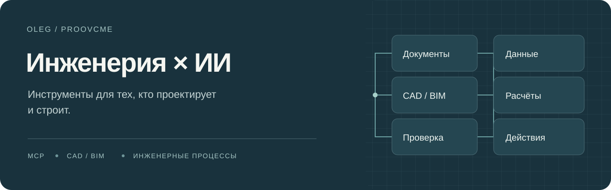

**Делаю инструменты, с которыми ИИ может работать со строительным проектом:**
читать документы, связывать данные между разделами, пользоваться CAD/BIM,
выполнять расчёты и объяснять результат через источники.

Локальные MCP-серверы, инженерные навыки и рабочие среды для проектировщиков,
руководителей проектов и ГИПов.

## Проекты

| Проект | Задача |
|---|---|
| **[Увязка](https://github.com/proovcme/uvyazka)** | Общая память проекта, сопоставление данных, графы работ и моделирование. Ранняя alpha. |
| **[ЛЕС](https://github.com/proovcme/LES)** | Документы, память и проверяемые источники для ИИ. Windows, локальные модели и API. |
| **[RU AEC Skills](https://github.com/proovcme/ru-aec-skills)** | Рабочие инструкции для инженерных задач: исходные данные, расчёты, координация и документация. |
| **[ФГИС ЦС · MCP](https://github.com/proovcme/fgis-mcp)** | Доступ ИИ-инструментов к открытым данным ФГИС ЦС: справочникам, сметным данным и документам. |
| **[Renga · MCP](https://github.com/proovcme/rnpmcp)** | Инструменты и навыки для работы с Renga BIM через COM API. |
| **[Узел](https://github.com/proovcme/uzel)** | Локальная рабочая среда ИИ для Apple Silicon: модели, документы и совместная работа с агентами. |

Также: **[Лемма](https://github.com/proovcme/lemma)** — управление проектной организацией ·
**[Locia](https://github.com/proovcme/locia)** — инструменты для проектной работы.

## Что связывает эти проекты

**Источники.** У числа, требования и вывода должно быть понятное происхождение.

**Согласованность.** Проект — единый объект. Помещения, оборудование, системы,
схемы, ведомости и расчёты должны быть связаны между собой.

**Действия с проверкой.** Найти расхождение, подготовить изменение, выполнить
его инструментом и проверить результат. Возможности и ограничения каждого
проекта описаны в его репозитории.

---

Избранные проекты за июль—октябрь 2026 · AI tools for the built environment.
